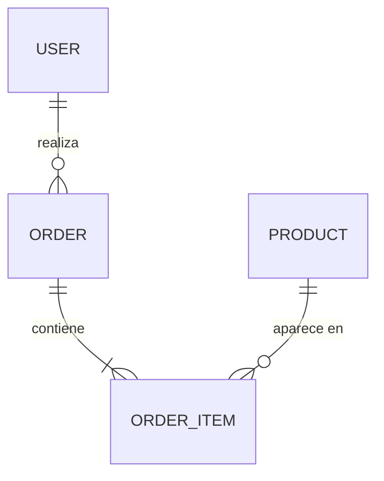

# ecommerce_api_reto_ia
Reto IA en ingeniería de Software UIS

API REST de comercio electrónico (usuarios, productos y pedidos) hecha con FastAPI, SQLAlchemy y MySQL. Es el repositorio base del reto *Auditoría, Refactorización y Evaluación de Herramientas IA en Software* (Ingeniería de Software I, UIS), auditado y corregido con apoyo de Claude Code.

## Arquitectura

```
main.py             App FastAPI: endpoints y regla de descuento
models.py           Modelos SQLAlchemy (tablas de la base de datos)
schemas.py          Esquemas Pydantic de entrada y de salida
database.py         Conexión a MySQL (variable DATABASE_URL) y una sesión por petición
tests/              Pruebas con pytest sobre SQLite en memoria
Dockerfile          Imagen de la API
docker-compose.yml  API + MySQL con volumen persistente
```

Cada petición recibe su propia sesión de base de datos (`database.get_db`), que se cierra al terminar. Las tablas se crean al arrancar la app con `create_all`; no hay migraciones.



Cada línea de pedido (`order_items`) guarda el producto, la cantidad y el precio unitario que se cobró, para que el historial no cambie si luego cambia el precio del producto.

### Reglas de negocio
- **Descuento:** los productos que cuestan más de 100 tienen un 10 % de descuento. Se configura con `DISCOUNT_THRESHOLD` y `DISCOUNT_RATE` en `main.py`.
- **Stock:** si falta stock de algún producto, el pedido se rechaza con 409 y no se modifica nada. Las filas de los productos se bloquean (`SELECT … FOR UPDATE`) hasta confirmar el pedido, para que dos pedidos simultáneos no vendan el mismo stock.
- **Cantidades:** repetir un id en `product_ids` pide una unidad más de ese producto.

## Endpoints

| Método | Ruta | Descripción | Respuestas |
|---|---|---|---|
| `POST` | `/users/` | Crea un usuario | 201, 422 |
| `GET` | `/users/{user_id}/orders` | Historial de pedidos del usuario, del más reciente al más antiguo, con los nombres de los productos | 200, 404 |
| `GET` | `/products/?limit=20&offset=0` | Lista paginada de productos, ordenada por id. `limit` entre 1 y 100 (20 por defecto), `offset` desde 0 | 200, 422 |
| `POST` | `/orders/` | Crea un pedido y descuenta el stock | 201; 400 producto inexistente; 404 usuario inexistente; 409 stock insuficiente |

Con la API en marcha, la documentación interactiva está en <http://localhost:8000/docs> (Swagger) y <http://localhost:8000/redoc>.

Ejemplo: pedido de dos unidades del producto 1 y una del producto 3.

```bash
curl -X POST http://localhost:8000/orders/ -H "Content-Type: application/json" -d '{"user_id": 1, "product_ids": [1, 1, 3]}'
```

No hay endpoint para crear productos; se insertan directamente en la base de datos (ver abajo).

## Ejecutar con Docker

Requiere Docker con Docker Compose.

1. Copia `.env.example` como `.env` y cambia las claves de MySQL. Usa solo letras, números y guiones, porque la clave va dentro de la URL de conexión.
2. Levanta la API y la base de datos:
   ```bash
   docker compose up --build
   ```
3. Abre <http://localhost:8000/docs>.

Para cargar productos de prueba (pide la clave root del `.env`):

```bash
docker compose exec db mysql -uroot -p ecommerce_db -e "INSERT INTO products (name, price, stock) VALUES ('Teclado', 50, 10), ('Monitor', 150, 5);"
```

Los datos se guardan en el volumen `mysql_data` y sobreviven a `docker compose down`. Para borrarlos: `docker compose down -v`.

## Ejecutar en local (sin Docker)

Requiere Python 3.13 y un servidor MySQL 8 con la base de datos `ecommerce_db` creada.

1. Crea y activa un entorno virtual:
   ```bash
   python -m venv .venv
   ```
   En Windows se activa con `.venv\Scripts\activate`; en Linux y macOS, con `source .venv/bin/activate`.
2. Instala las dependencias: `pip install -r requirements.txt`
3. Copia `.env.example` como `.env` y ajusta `DATABASE_URL`. El `.env` no se sube al repositorio.
4. Arranca la API: `uvicorn main:app --reload`

## Pruebas

```bash
pip install -r requirements-dev.txt
pytest
```

- Las pruebas usan SQLite en memoria, así que no necesitan MySQL ni un `.env`.
- `pytest` muestra la cobertura por archivo y falla si baja del 70 %.
- Cubren la regla de descuento, la configuración de la base de datos, la restricción de stock, la creación de usuarios, la paginación, los pedidos (stock, descuentos y errores sin cambios parciales) y el historial (orden, nombres de productos y número de consultas constante).
- No cubren la concurrencia real: SQLite ignora `FOR UPDATE`, así que el bloqueo de filas solo se puede comprobar contra MySQL.

## Limitaciones conocidas
- **Sin autenticación ni autorización.** Ningún endpoint pide credenciales: cualquiera puede crear usuarios y hacer pedidos a nombre de cualquier `user_id`. Además, `POST /orders/` responde 404 si el usuario no existe, lo que permite averiguar qué ids de usuario existen. El reto no pide autenticación, así que se deja así a propósito, pero la API no es apta para producción.
- Para producción haría falta: autenticación OAuth2 con tokens JWT (`fastapi.security`), tomar el usuario del token en lugar del `user_id` del cuerpo del pedido, y limitar la frecuencia de peticiones.
- Otros pendientes de la auditoría: el dinero se guarda como `Float` en vez de `Numeric`; el email no se valida ni es único; `product_ids` acepta una lista vacía; no hay migraciones (Alembic); las fechas se guardan en hora local sin zona horaria.
- Los pedidos creados antes de existir la tabla `order_items` aparecen en el historial sin productos.
